# Laboratoire Monte Carlo de pricing et de risque, validé

Un moteur Monte Carlo pour options (GBM, Heston QE, Merton, asiatiques, barrières, put américain, grecques, MLMC) et un volet risque (VaR 99 % et ES 97,5 % par cinq méthodes, toutes backtestées) où **chaque nombre a une barre d'erreur, chaque prix est validé contre une référence indépendante et chaque technique d'amélioration a un gain chiffré**.

*A validated Monte Carlo lab for option pricing and market risk: every number comes with a standard error, every price is checked against an independent reference, every variance-reduction technique has a measured gain, and five VaR/ES methods are backtested like a risk controller would.*

  

> **Ce dépôt ne contient aucune stratégie de trading** : rien ne s'y négocie, donc il n'y a ni courbe d'equity ni frais de transaction. Le tableau « Hypothèses » dit ce qui est fixé, et les tableaux de validation tiennent la place des métriques de performance : on y lit d'un coup d'œil si un nombre est fiable.

## Hypothèses (à lire en premier)

| Élément | Valeur |
|---|---|
| **Frais et coûts** | Aucun : le labo valorise des produits et mesure des risques, il n'exécute pas d'ordres. La VaR et l'ES portent sur la variation de valeur brute de frais d'un portefeuille réévalué en totalité chaque jour. |
| **Cas de référence (pricing)** | Call européen S0 = K = 100, T = 1 an, r = 2 %, σ = 20 % ; Heston v0 = θ = 0,04, κ = 1,5, ξ = 0,5, ρ = −0,7 (viole la condition de Feller : 2κθ = 0,12 < ξ² = 0,25) ; Merton λ = 0,5, μ_J = −0,1, δ_J = 0,15. |
| **Règle de verdict** | Un cas est **OK** si \|estimation − référence\| < 3 erreurs-types (plus, quand c'est écrit, un biais de discrétisation documenté). Références : formules fermées ou semi-fermées, arbre CRR à 2 000 pas, Monte Carlo haute précision. |
| **Aléa** | `np.random.default_rng(graine)` partout : deux exécutions donnent les mêmes nombres (hors chronométrages). |
| **Données du volet risque** | 7 lignes longues (EURUSD 20 %, USDJPY 15 %, GBPUSD 15 %, XAUUSD 15 %, BCOUSD 10 %, SPXUSD 15 %, NSXUSD 10 %), notionnel 10 M€, clôture quotidienne tirée de barres 1 h ; 4 011 rendements du 2010-11-16 au 2026-06-26. **Données de marché non redistribuées** : définir `UNIVERS_DIR` (dossier des `<ACTIF>_1h.csv`) ; sans elles, les tests concernés sont ignorés et les résultats du dépôt (`results/*.json`) restent consultables. |
| **Découpage TRAIN / VAL / TEST** | Sans objet : aucun paramètre n'est ajusté sur un résultat. Fenêtre 500 j, λ EWMA = 0,94, refit GARCH tous les 20 j, 10 000 tirages sont fixés avant tout calcul. Le backtest est strictement hors échantillon et glissant : 2012-10-25 → 2026-06-26, 3 511 jours. Aucun jeu TEST n'est scellé, car rien n'est optimisé sur ce jeu. |
| **Délai d'exécution** | Sans objet (pas d'ordres). Protocole causal : la prévision du jour t n'utilise que les rendements jusqu'à t−1 ; un test de non-fuite le vérifie (voir `docs/risque.md`). |

## Métriques de validation

**Pricing** : chaque ligne compare une estimation Monte Carlo à une référence indépendante (z = (estimation − référence) / erreur-type).

<!-- AUTO:tete_validation:DEBUT -->
| Cas | Méthode | Référence | Estimation | Erreur-type | z | Verdict |
|---|---|---|---|---|---|---|
| Call européen BS | MC naïf | 8.9160 | 8.8668 | 0.0194 | -2.53 | OK |
| Call européen BS | QMC Sobol randomisé (16 x 2^14) | 8.9160 | 8.9159 | 0.0001 | -1.98 | OK |
| Call Heston | QE d'Andersen (20 pas) | 8.1950 | 8.2135 | 0.0138 | +1.35 | OK |
| Call Heston | QE numba parallèle (50 pas) | 8.1950 | 8.1876 | 0.0048 | -1.53 | OK |
| Call Merton | schéma exact (Poisson) | 10.1272 | 10.1423 | 0.0221 | +0.68 | OK |
| Asiatique géométrique (12 dates) | QMC pont (16 x 2^12) | 5.1909 | 5.1907 | 0.0008 | -0.18 | OK |
| Asiatique arithmétique (12 dates) | VC asiatique géométrique | 5.3782 | 5.3783 | 0.0005 | +0.18 | OK |
| Call très OTM (K=180) | importance sampling (mu=2.94) | 0.0177 | 0.0177 | 0.0001 | +0.35 | OK |
| Down-and-out call (H=90, 50 dates) | pont brownien | 7.3004 | 7.3131 | 0.0190 | +0.67 | OK |
| Down-and-out call (H=90, 50 dates) | MC naïf (grille) | 7.3004 | 7.7682 | 0.0194 | +24.14 | échec attendu (démo) |
| Put américain LSM (50 dates) | Longstaff-Schwartz, Laguerre deg. 3, évaluation indépendante | 5.7849 | 5.7703 | 0.0096 | -1.53 | OK |
| MLMC GBM (Euler) | MLMC de Giles, eps=0.01 | 8.9160 | 8.9169 | 0.0071 | +0.13 | OK |
| Grecque delta (call) | pathwise | 0.5793 | 0.5792 | 0.0008 | -0.08 | OK |

*45 cas au total : 42 OK, 3 démonstrations d'échec volontaires (MC naïf sur barrière discrète, pathwise sur digitale). Parmi les 37 cas sans biais de discrétisation toléré, le pire |z| vaut 2.53 (Call européen BS, MC naïf). Table complète des 45 cas plus bas. Frais : aucun (le labo ne trade pas).*
<!-- AUTO:tete_validation:FIN -->

**Risque** : cinq méthodes de VaR/ES, jugées comme le ferait une fonction Contrôle des risques.

<!-- AUTO:tete_risque:DEBUT -->
Backtest de la VaR 99 % à 1 jour sur 3511 jours (2012-10-25 → 2026-06-26), portefeuille de 10 M€, **35.1 exceptions attendues**. p-values : rejet à 5 % si p < 0,05 (en gras).

| Méthode | VaR 99 % moyenne | Exceptions | Kupiec (p) | Christoffersen indép. (p) | Christoffersen cc (p) | ES 97,5 % Z2 (p) | Verdict |
|---|---|---|---|---|---|---|---|
| Simulation historique | 1.38 % du notionnel | 47 (attendu 35) | 0.055 | **0.000** | **0.000** | **0.004** | rejetée : indépendance, cc, ES |
| Normale EWMA | 1.08 % du notionnel | 73 (attendu 35) | **0.000** | **0.021** | **0.000** | **0.000** | rejetée : Kupiec, indépendance, cc, ES |
| Monte Carlo Student-t | 1.15 % du notionnel | 59 (attendu 35) | **0.000** | **0.019** | **0.000** | **0.000** | rejetée : Kupiec, indépendance, cc, ES |
| FHS (GARCH) | 1.31 % du notionnel | 38 (attendu 35) | 0.629 | 0.070 | 0.172 | 0.378 | passe les 4 tests |
| Copule t + GARCH | 1.17 % du notionnel | 52 (attendu 35) | **0.008** | **0.048** | **0.004** | **0.011** | rejetée : Kupiec, indépendance, cc, ES |
<!-- AUTO:tete_risque:FIN -->

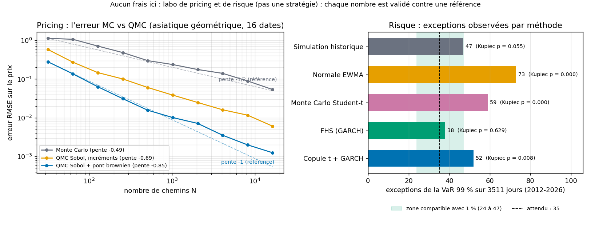

**Comment lire ce graphique.** À gauche, plus la courbe descend vite quand N augmente, plus la méthode est précise : le Monte Carlo suit la pente −1/2, le QMC avec pont brownien s'approche de −1 (même précision avec beaucoup moins de chemins). À droite, chaque barre est le nombre de fois où la perte a dépassé la VaR 99 % ; la bande verte est ce qu'un bon modèle à 1 % produirait par hasard : une barre hors de la bande est un modèle rejeté par Kupiec.

## Fiable ou pas ? Lecture en 30 secondes

<!-- AUTO:tete_lecture:DEBUT -->
- **Les barres d'erreur sont honnêtes** : sur 1 000 répétitions indépendantes, l'IC95 contient la vraie valeur 94.3 % à 95.6 % du temps (5 estimateurs), et le contre-exemple de l'événement rare est montré, pas caché (75.6 % pour le MC naïf sur le call K = 180).
- **Aucun prix n'est publié sans référence indépendante** : 37 cas sur 37 (hors biais de discrétisation documenté) sont à moins de 3 erreurs-types de leur formule fermée, semi-fermée ou arbre fin, et 3 démonstrations d'échec sont affichées comme telles.
- **Rien n'est réglé sur le backtest du risque** : fenêtre 500 j, lambda = 0.94, refit GARCH 20 j, 10 000 tirages sont fixés avant les calculs ; résultat : 1 méthode sur 5 (FHS (GARCH)) passe les quatre tests, les autres sont rejetées et dites telles. Et un backtest de 1 an ne détecte un modèle à 2 % d'exceptions que 24 % du temps (Q7 de l'approfondissement).
<!-- AUTO:tete_lecture:FIN -->

## Toutes les variantes

Rien n'est caché : toutes les méthodes testées sont listées, y compris celles qui échouent.

**Pricing et grecques, résumé par thème** (le détail des 45 cas est dans « Résultats de validation » plus bas).

<!-- AUTO:variantes_pricing:DEBUT -->
| Thème | Méthodes comparées | Référence | Pire z | Verdict |
|---|---|---|---|---|
| Call européen BS | MC naïf ; MC antithétique ; VC sur S_T ; QMC Sobol randomisé (16 x 2^14) | formule fermée | -2.53 | OK |
| Call Heston | Euler full-truncation (100 pas) ; QE d'Andersen (20 pas) ; QE numba parallèle (50 pas) | semi-fermé (Fourier) | +1.87 | OK |
| Call Merton | schéma exact (Poisson) | série de Merton | +0.68 | OK |
| Asiatique géométrique (12 dates) | MC naïf ; QMC pont (16 x 2^12) | formule fermée | +0.97 | OK |
| Asiatique arithmétique (12 dates) | MC naïf ; MC antithétique ; VC asiatique géométrique ; QMC pont (16 x 2^12) | MC haute précision (VC, 2 M chemins, SE=1.5e-04) | -0.80 | OK |
| Call très OTM (K=180) | MC naïf ; importance sampling (mu=2.94) | formule fermée | -1.51 | OK |
| Down-and-out call (H=90, 50 dates) | MC naïf (grille) ; décalage BGK ; pont brownien | formule continue (Reiner-Rubinstein) | +24.14 | contient une démo d'échec attendue : MC naïf (grille) |
| Put américain LSM (50 dates) | Longstaff-Schwartz, Laguerre deg. 3, évaluation indépendante | arbre CRR bermudéen (N=2000, 50 dates) | -1.53 | OK |
| Put américain LSM, cas Longstaff-Schwartz (S0=36, K=40) | Longstaff-Schwartz, 50 dates | arbre CRR bermudéen (N=2000, 50 dates) | -1.13 | OK |
| Put américain LSM, cas Longstaff-Schwartz (S0=40, K=40) | Longstaff-Schwartz, 50 dates | arbre CRR bermudéen (N=2000, 50 dates) | -1.50 | OK |
| Put américain LSM, cas Longstaff-Schwartz (S0=44, K=40) | Longstaff-Schwartz, 50 dates | arbre CRR bermudéen (N=2000, 50 dates) | -1.60 | OK |
| Put américain LSM (10 dates) | Longstaff-Schwartz | arbre CRR bermudéen (N=2000, 10 dates) | -1.16 | OK |
| Put américain, borne duale (10 dates) | Rogers / Haugh-Kogan (valeur LSM deg. 7, quadrature) | arbre CRR bermudéen (N=2000, 10 dates) | +11.34 | OK, grâce à un biais toléré et documenté (borne haute de la dualité) |
| Grecque delta (call) | pathwise ; lr ; bump | formule fermée BS | -1.00 | OK |
| Grecque gamma (call) | lr ; bump | formule fermée BS | -1.35 | OK |
| Grecque vega (call) | pathwise ; lr ; bump | formule fermée BS | -0.93 | OK |
| Grecque delta (digitale) | pathwise ; lr ; bump | formule fermée BS | -0.69 | contient une démo d'échec attendue : pathwise |
| Grecque vega (digitale) | pathwise ; lr ; bump | formule fermée BS | +1.44 | contient une démo d'échec attendue : pathwise |
| MLMC GBM (Euler) | MLMC de Giles, eps=0.01 | formule fermée BS | +0.13 | OK |
| MLMC Heston (Euler) | MLMC de Giles, eps=0.05 | semi-fermé (Fourier) | +1.95 | OK |
| Parité call-put sur prix MC | GBM exact ; Heston QE ; Heston Euler ; Merton exact | S0 e^{-qT} - K e^{-rT} | +1.12 | OK |
<!-- AUTO:variantes_pricing:FIN -->

**Réduction de variance, QMC et importance sampling : gain de chaque technique.**

<!-- AUTO:variantes_vr:DEBUT -->
| Technique | Cas | Facteur de variance | Facteur d'efficacité (variance × temps) |
|---|---|---|---|
| antithétique | Européen | ×1.7 | ×1.8 |
| VC sur S_T | Européen | ×5.5 | ×5.0 |
| antithétique | Asiatique arith. | ×1.8 | ×1.8 |
| VC géométrique | Asiatique arith. | ×1383.3 | ×936.4 |
| importance sampling | Call OTM K=180 | ×584.3 | ×714.4 |
| Stratification proportionnelle (H = 64) | Européen ATM, brownien terminal | ×92 | non chronométré |
| Stratification de Neyman, σ_h connus (H = 64) | Européen ATM | ×1110 | non chronométré |
| Stratification de Neyman, pilote n/8 (H = 64) | Call OTM K = 140 | ×180 | non chronométré |
| Hypercube latin (n = 4096) | Asiatique 16 dates, pont | ×10 | non chronométré |
| Importance sampling, dérive optimale μ* | Call OTM K = 180 | ×882 | non chronométré |
| Importance sampling, entropie croisée | Call OTM K = 180 | ×873 | non chronométré |
| QMC Sobol + pont brownien (N = 2^14, rapport de RMSE²) | Asiatique 16 dates | ×1901 | non chronométré |
| QMC Sobol + ACP (N = 2^14, rapport de RMSE²) | Asiatique 16 dates | ×12007 | non chronométré |

*Les cinq premières lignes viennent de `results/validation.json` (efficacité = variance × temps mesuré). Les huit suivantes viennent de `results/approfondissement.json` (Q3, Q4, Q5) : leur coût par tirage est voisin de celui du MC naïf, donc l'efficacité vaut à peu près le facteur de variance, mais elle n'est pas chronométrée.*
<!-- AUTO:variantes_vr:FIN -->

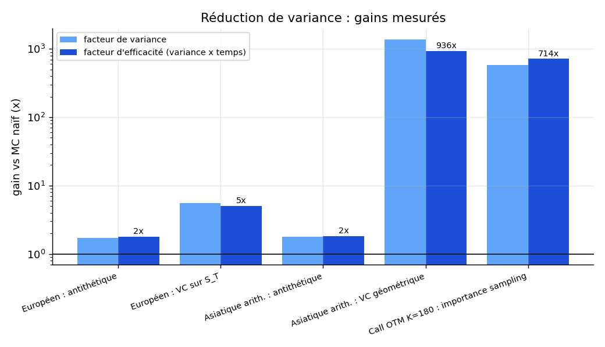

**Comment lire ce graphique.** Chaque barre est le nombre de fois où une technique divise la variance (échelle logarithmique) par rapport au Monte Carlo naïf. L'antithétique ne gagne qu'un facteur 2 environ, la variable de contrôle géométrique sur l'asiatique et l'importance sampling sur l'option très hors de la monnaie gagnent plusieurs centaines à un millier : tout dépend de la corrélation avec une quantité connue ou de la rareté de l'événement.

**Les cinq méthodes de VaR/ES (portefeuille de 10 M€).**

<!-- AUTO:variantes_var:DEBUT -->
| Méthode | Principe | VaR 99 % moy. | ES 97,5 % moy. | Exceptions | Zone verte Bâle | COVID 9 mars 2020 : perte / VaR |
|---|---|---|---|---|---|---|
| Simulation historique | quantile des 500 dernières pertes | 138 281 € | 140 469 € | 47 / 3511 | 69 % | ×3.56 |
| Normale EWMA | gaussienne, covariance EWMA (lambda = 0,94) | 108 302 € | 108 836 € | 73 / 3511 | 44 % | ×2.50 |
| Monte Carlo Student-t | Student multivarié, covariance EWMA | 114 771 € | 117 565 € | 59 / 3511 | 59 % | ×2.37 |
| FHS (GARCH) | GARCH(1,1) + bootstrap de résidus standardisés | 130 556 € | 134 577 € | 38 / 3511 | 80 % | ×1.91 |
| Copule t + GARCH | marges GARCH + copule t | 117 039 € | 120 067 € | 52 / 3511 | 65 % | ×2.10 |

*Pertes sur un portefeuille de 10 M€, réévaluation complète. « Zone verte » : part des fenêtres glissantes de 250 jours avec au plus 4 exceptions. La dernière colonne vaut plus de 1 quand la perte réalisée dépasse la VaR du jour.*
<!-- AUTO:variantes_var:FIN -->

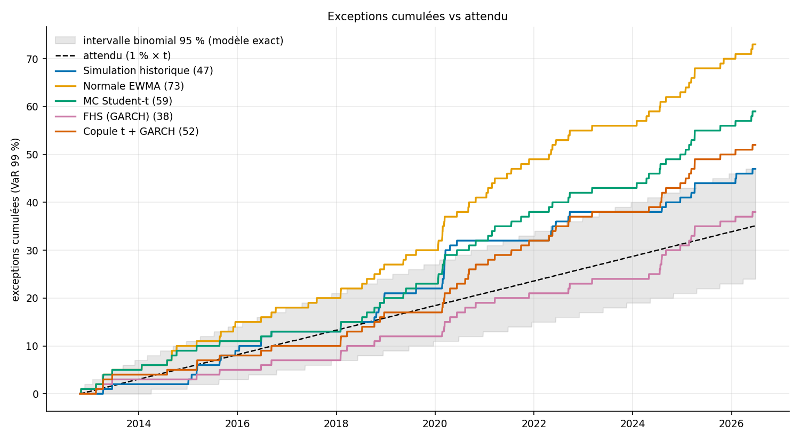

**Comment lire ce graphique.** Chaque courbe compte les exceptions cumulées d'une méthode ; la droite en pointillé est ce qu'on attend à 1 % et la bande grise l'intervalle binomial à 95 % d'un modèle exact. Une courbe qui sort de la bande par le haut sous-estime le risque ; un saut brutal marque une crise (mars 2020). Le détail méthode par méthode est dans [docs/risque.md](docs/risque.md).

## Pourquoi ce projet

Un desk de trading ou une équipe de pricing ne se fie à un prix ou à une VaR que si on sait **à quel point on peut s'y fier** : erreur-type, référence indépendante, gain mesuré de chaque technique, test du modèle de risque. C'est exactement le travail d'un quant de support au trading (valider un pricer, accélérer une simulation, justifier un chiffre devant le risque) pour une plateforme de trading comme smartTrade ou une équipe de recherche quantitative comme Xrays Trading.

> Gestion des risques (VaR/ES Monte Carlo) : voir [docs/risque.md](docs/risque.md). Approfondissement théorique (Euler/Milstein, MLMC, QMC, stratification, importance sampling, AAD, puissance des backtests, Feller) : section « Approfondissement » plus bas et `notebooks/approfondissement.ipynb`.

## Méthode en bref

- **Estimateur et erreur-type.** Un prix est une espérance, $C = e^{-rT}\,\mathbb{E}[(S_T-K)^+]$ ; on la remplace par la moyenne de $n$ payoffs simulés, avec $\mathrm{SE} = s/\sqrt n$ et $\mathrm{IC}_{95} = \hat C \pm 1{,}96\,\mathrm{SE}$. Le score $z = (\hat C - C_{\text{réf}})/\mathrm{SE}$ dit si l'écart à la référence est du bruit (|z| < 3) ou un biais.
- **Réduire la variance.** Antithétique (tirer $Z$ et $-Z$), variable de contrôle (soustraire une quantité corrélée d'espérance connue), importance sampling (tirer là où le payoff vit, corriger par le poids de Girsanov), stratification, hypercube latin ; le gain est le rapport des variances, et le facteur d'**efficacité** le multiplie par le rapport des temps de calcul.
- **Quasi-Monte Carlo.** Suite de Sobol brouillée plus pont brownien : l'erreur décroît plus vite que $N^{-1/2}$ parce que la variance est portée par les premières coordonnées (voir Q3).
- **Discrétiser.** Euler, Milstein, QE d'Andersen pour Heston ; MLMC de Giles : $\mathbb{E}[P_L] = \mathbb{E}[P_0] + \sum_l \mathbb{E}[P_l - P_{l-1}]$, avec le même brownien sur deux grilles consécutives.
- **Risque.** VaR 99 % = quantile de la perte à 1 jour, ES 97,5 % = moyenne de la perte au-delà ; cinq méthodes, chacune jugée par Kupiec (nombre d'exceptions), Christoffersen (leur indépendance), les feux de Bâle et le test de l'ES d'Acerbi-Székely, avec une prévision du jour $t$ qui n'utilise que les rendements jusqu'à $t-1$.

## Objectif

Montrer, sur un cas complet, les réflexes d'un quant : ne jamais publier un prix sans **erreur-type et IC95**, le
**valider** (formule fermée, semi-fermée ou arbre fin), mesurer la **vitesse de convergence**, chiffrer le **gain**
de chaque réduction de variance, et vérifier que les barres d'erreur elles-mêmes sont **honnêtes** (test de couverture).

Chaque estimateur renvoie un `ResultatMC(prix, erreur_type, ic_bas, ic_haut, n_chemins, temps_s)`.

## Modules (`mclab/`)

| Module | Contenu | Validé contre |
|---|---|---|
| `utils.py` | `ResultatMC`, résumé i.i.d. / antithétique, paramètres Heston et Merton, payoffs, vol implicite (brentq) | aller-retour prix -> vol -> prix |
| `analytique.py` | Black-Scholes + grecques (avec dividende q), **Heston** semi-fermé (fonction caractéristique « little trap », `quad`), **Merton** (série de Black), asiatique **géométrique** discrète, **down-and-out** continu, digitale, put américain **CRR** (N=2000) | limites connues (Heston -> BS quand la vol de vol tend vers 0, Merton sans saut, parités, différences finies) |
| `modeles.py` | GBM exact ; Heston **Euler full-truncation** et **QE d'Andersen (2008)** ; Merton exact (Poisson + sauts lognormaux) ; tirages fournis (QMC) et antithétique | Heston semi-fermé, série de Merton, BS |
| `reduction_variance.py` | antithétique ; **variable de contrôle** (S_T pour l'européenne, asiatique géométrique pour l'arithmétique, beta sur un **pilote indépendant**) ; **importance sampling** par translation de drift (call très OTM) ; facteurs de variance et d'efficacité | BS, MC haute précision |
| `qmc.py` | **Sobol brouillé** + normale inverse + **pont brownien** ; QMC **randomisé** (K brouillages -> erreur-type, IC de Student) ; étude de convergence RMSE vs N | asiatique géométrique (formule exacte) |
| `barriere.py` | down-and-out discret : **naïf** vs **pont brownien** vs décalage BGK | formule continue de Reiner-Rubinstein |
| `americaine.py` | **Longstaff-Schwartz** (Laguerre deg. 3, règle apprise sur un jeu, prix évalué sur un **autre jeu indépendant**), frontière d'exercice, **borne haute duale** | arbre CRR (mêmes dates d'exercice) |
| `grecques.py` | **pathwise**, **rapport de vraisemblance**, **bump-and-revalue avec nombres aléatoires communs** ; cas **digital** | Black-Scholes, digitale fermée |
| `mlmc.py` | **MLMC de Giles** (Euler ou Milstein, raffinement x2, niveaux adaptatifs), call GBM puis Heston, exposants alpha/beta/gamma mesurés, coût vs eps | BS, Heston semi-fermé |
| `accel.py` | simulation **Heston QE en numba** (`@njit(parallel=True)`), benchmark numpy vs numba | Heston semi-fermé |
| `validation.py` | **couverture des IC95** par répétitions, **parité call-put** sur prix MC | (contrôle des estimateurs eux-mêmes) |
| `risque.py` | **VaR 99 % / ES 97,5 %** par 5 méthodes (historique, EWMA normale, MC Student-t, FHS-GARCH, copule t), tests de Kupiec, Christoffersen, feux de Bâle, Acerbi-Székely | backtest causal sur 3 511 jours (voir [docs/risque.md](docs/risque.md)) |
| `schemas.py` | **Euler, Milstein** (GBM, CIR), Heston full-truncation et QE, erreurs forte et faible, régression des ordres | solution exacte du GBM, Heston semi-fermé |
| `anova.py` | **dimension effective** : indices de Sobol fermés (pick-freeze), indices d'ordre 1 (Hermite), constructions incrémentale / pont / ACP | exponentielle linéaire (indice exact connu) |
| `stratification.py` | **stratification** proportionnelle et de Neyman, **hypercube latin** | variances théoriques par quadrature |
| `importance.py` | **importance sampling** gaussien : second moment M(mu), dérive optimale, entropie croisée, grandes déviations | quadrature adaptative |
| `aad.py` | **différentiation adjointe (AAD)** codée à la main pour un GBM discret, contre pathwise, bump-and-revalue | Black-Scholes, asiatique géométrique fermée |
| `puissance.py` | **puissance de Kupiec / Christoffersen** (énumération binomiale exacte et simulation), zones de Bâle | formules exactes |
| `contributions_es.py` | **contributions d'Euler à l'ES** (somme = ES), vérifiées par dérivées numériques | théorème d'Euler (homogénéité de degré 1) |
| `experiences.py` | les huit expériences Q1 à Q8 de l'approfondissement (une fonction par question, blocs JSON) | (appelle les modules ci-dessus) |

## Résultats de validation

Règle du verdict : **OK si |estimation - référence| < 3 erreurs-types** (plus, quand c'est écrit, un biais de
discrétisation documenté). Les 45 cas ci-dessous sont **lus dans `results/validation.json`** (régénéré par
`scripts/run_all.py`, graines fixées) ; le tableau est réinjecté automatiquement dans ce README. Lignes marquées
« échec attendu » : démonstrations volontaires (MC naïf sur barrière discrète, pathwise sur une digitale).

### Prix

<!-- AUTO:prix:DEBUT -->
| Cas | Méthode | Estimation ± SE | IC95 | Référence | z | Verdict |
|---|---|---|---|---|---|---|
| Call européen BS | MC naïf | 8.8668 ± 0.0194 | [8.8287 ; 8.9049] | 8.9160 | -2.53 | OK |
| Call européen BS | MC antithétique | 8.8968 ± 0.0149 | [8.8676 ; 8.9260] | 8.9160 | -1.29 | OK |
| Call européen BS | VC sur S_T | 8.9155 ± 0.0083 | [8.8992 ; 8.9317] | 8.9160 | -0.07 | OK |
| Call européen BS | QMC Sobol randomisé (16 x 2^14) | 8.9159 ± 0.0001 | [8.9157 ; 8.9161] | 8.9160 | -1.98 | OK |
| Call Heston | Euler full-truncation (100 pas) | 8.2357 ± 0.0218 | [8.1931 ; 8.2784] | 8.1950 | +1.87 | OK |
| Call Heston | QE d'Andersen (20 pas) | 8.2135 ± 0.0138 | [8.1866 ; 8.2405] | 8.1950 | +1.35 | OK |
| Call Heston | QE numba parallèle (50 pas) | 8.1876 ± 0.0048 | [8.1781 ; 8.1971] | 8.1950 | -1.53 | OK |
| Call Merton | schéma exact (Poisson) | 10.1423 ± 0.0221 | [10.0989 ; 10.1856] | 10.1272 | +0.68 | OK |
| Asiatique géométrique (12 dates) | MC naïf | 5.2016 ± 0.0111 | [5.1798 ; 5.2234] | 5.1909 | +0.97 | OK |
| Asiatique géométrique (12 dates) | QMC pont (16 x 2^12) | 5.1907 ± 0.0008 | [5.1891 ; 5.1924] | 5.1909 | -0.18 | OK |
| Asiatique arithmétique (12 dates) | MC naïf | 5.3659 ± 0.0181 | [5.3304 ; 5.4014] | 5.3782 | -0.68 | OK |
| Asiatique arithmétique (12 dates) | MC antithétique | 5.3674 ± 0.0136 | [5.3408 ; 5.3940] | 5.3782 | -0.80 | OK |
| Asiatique arithmétique (12 dates) | VC asiatique géométrique | 5.3783 ± 0.0005 | [5.3774 ; 5.3793] | 5.3782 | +0.18 | OK |
| Asiatique arithmétique (12 dates) | QMC pont (16 x 2^12) | 5.3776 ± 0.0009 | [5.3755 ; 5.3796] | 5.3782 | -0.69 | OK |
| Call très OTM (K=180) | MC naïf | 0.0158 ± 0.0012 | [0.0134 ; 0.0182] | 0.0177 | -1.51 | OK |
| Call très OTM (K=180) | importance sampling (mu=2.94) | 0.0177 ± 0.0001 | [0.0176 ; 0.0178] | 0.0177 | +0.35 | OK |
| Down-and-out call (H=90, 50 dates) | MC naïf (grille) | 7.7682 ± 0.0194 | [7.7302 ; 7.8062] | 7.3004 | +24.14 | échec attendu (démo) |
| Down-and-out call (H=90, 50 dates) | décalage BGK | 7.3134 ± 0.0192 | [7.2758 ; 7.3510] | 7.3004 | +0.68 | OK |
| Down-and-out call (H=90, 50 dates) | pont brownien | 7.3131 ± 0.0190 | [7.2758 ; 7.3504] | 7.3004 | +0.67 | OK |
| Put américain LSM (50 dates) | Longstaff-Schwartz, Laguerre deg. 3, évaluation indépendante | 5.7703 ± 0.0096 | [5.7515 ; 5.7891] | 5.7849 | -1.53 | OK |
| Put américain LSM, cas Longstaff-Schwartz (S0=36, K=40) | Longstaff-Schwartz, 50 dates | 4.4712 ± 0.0061 | [4.4593 ; 4.4831] | 4.4780 | -1.13 | OK |
| Put américain LSM, cas Longstaff-Schwartz (S0=40, K=40) | Longstaff-Schwartz, 50 dates | 2.3058 ± 0.0054 | [2.2951 ; 2.3165] | 2.3140 | -1.50 | OK |
| Put américain LSM, cas Longstaff-Schwartz (S0=44, K=40) | Longstaff-Schwartz, 50 dates | 1.1012 ± 0.0055 | [1.0904 ; 1.1121] | 1.1101 | -1.60 | OK |
| Put américain LSM (10 dates) | Longstaff-Schwartz | 5.7205 ± 0.0097 | [5.7015 ; 5.7396] | 5.7318 | -1.16 | OK |
| Put américain, borne duale (10 dates) | Rogers / Haugh-Kogan (valeur LSM deg. 7, quadrature) | 5.7650 ± 0.0029 | [5.7593 ; 5.7707] | 5.7318 | +11.34 | borne valide |
| MLMC GBM (Euler) | MLMC de Giles, eps=0.01 | 8.9169 ± 0.0071 | [8.9031 ; 8.9308] | 8.9160 | +0.13 | OK |
| MLMC Heston (Euler) | MLMC de Giles, eps=0.05 | 8.2639 ± 0.0354 | [8.1946 ; 8.3333] | 8.1950 | +1.95 | OK |
<!-- AUTO:prix:FIN -->

### Grecques (call et digitale, S0=K=100, T=1, r=2 %, sigma=20 %)

<!-- AUTO:grecques:DEBUT -->
| Cas | Méthode | Estimation ± SE | IC95 | Référence | z | Verdict |
|---|---|---|---|---|---|---|
| Grecque delta (call) | pathwise | 0.5792 ± 0.0008 | [0.5776 ; 0.5808] | 0.5793 | -0.08 | OK |
| Grecque delta (call) | lr | 0.5773 ± 0.0020 | [0.5734 ; 0.5811] | 0.5793 | -1.00 | OK |
| Grecque delta (call) | bump | 0.5792 ± 0.0008 | [0.5776 ; 0.5808] | 0.5793 | -0.11 | OK |
| Grecque gamma (call) | lr | 0.0194 ± 0.0002 | [0.0190 ; 0.0197] | 0.0196 | -0.93 | OK |
| Grecque gamma (call) | bump | 0.0193 ± 0.0002 | [0.0190 ; 0.0196] | 0.0196 | -1.35 | OK |
| Grecque vega (call) | pathwise | 39.0102 ± 0.1053 | [38.8039 ; 39.2165] | 39.1043 | -0.89 | OK |
| Grecque vega (call) | lr | 38.7572 ± 0.3734 | [38.0252 ; 39.4891] | 39.1043 | -0.93 | OK |
| Grecque vega (call) | bump | 39.0091 ± 0.1053 | [38.8028 ; 39.2154] | 39.1043 | -0.90 | OK |
| Grecque delta (digitale) | pathwise | 0.0000 ± 0.0000 | [0.0000 ; 0.0000] | 0.0196 | +inf | échec attendu (démo) |
| Grecque delta (digitale) | lr | 0.0195 ± 0.0000 | [0.0194 ; 0.0196] | 0.0196 | -0.69 | OK |
| Grecque delta (digitale) | bump | 0.0195 ± 0.0001 | [0.0192 ; 0.0198] | 0.0196 | -0.48 | OK |
| Grecque vega (digitale) | pathwise | 0.0000 ± 0.0000 | [0.0000 ; 0.0000] | -0.3910 | +inf | échec attendu (démo) |
| Grecque vega (digitale) | lr | -0.3986 ± 0.0064 | [-0.4111 ; -0.3861] | -0.3910 | -1.18 | OK |
| Grecque vega (digitale) | bump | -0.3823 ± 0.0061 | [-0.3942 ; -0.3703] | -0.3910 | +1.44 | OK |
<!-- AUTO:grecques:FIN -->

### Parité call-put sur les prix MC

<!-- AUTO:parite:DEBUT -->
| Cas | Méthode | Estimation ± SE | IC95 | Référence | z | Verdict |
|---|---|---|---|---|---|---|
| Parité call-put sur prix MC | GBM exact | 2.0122 ± 0.0286 | [1.9561 ; 2.0682] | 1.9801 | +1.12 | OK |
| Parité call-put sur prix MC | Heston QE | 1.9737 ± 0.0259 | [1.9230 ; 2.0245] | 1.9801 | -0.25 | OK |
| Parité call-put sur prix MC | Heston Euler | 1.9671 ± 0.0409 | [1.8870 ; 2.0472] | 1.9801 | -0.32 | OK |
| Parité call-put sur prix MC | Merton exact | 2.0152 ± 0.0330 | [1.9504 ; 2.0800] | 1.9801 | +1.06 | OK |
<!-- AUTO:parite:FIN -->

### Les IC95 sont-ils honnêtes ? Couverture sur répétitions indépendantes

Chaque estimateur est répété 1 000 fois avec des graines indépendantes (nombre de chemins petit, 2 000) ; on compte la
fraction d'IC95 contenant la vraie valeur. Attendu : 95 % à la fluctuation binomiale près.

<!-- AUTO:couverture:DEBUT -->
| Estimateur | Couverture observée | Attendu | Écart (en sigmas binomiaux) |
|---|---|---|---|
| MC naïf | 94.3 % (943/1000) | 95 % ± 1.4 pt | -1.0 |
| antithétique | 95.2 % (952/1000) | 95 % ± 1.4 pt | +0.3 |
| variable de contrôle | 95.6 % (956/1000) | 95 % ± 1.4 pt | +0.9 |
| importance sampling (call K=180) | 95.1 % (951/1000) | 95 % ± 1.4 pt | +0.1 |
| QMC randomisé (asiatique géo., 16 x 2^6) | 95.2 % (952/1000) | 95 % ± 1.4 pt | +0.3 |
| MC naïf sur call K=180 (événement rare, contre-exemple) | 75.6 % (756/1000) | 95 % ± 1.4 pt | -28.1 |
<!-- AUTO:couverture:FIN -->

### Réduction de variance : gains mesurés

<!-- AUTO:efficacite:DEBUT -->
| Technique | Facteur de variance | Facteur d'efficacité (variance x temps) |
|---|---|---|
| Européen : antithétique | 1.7x | 1.8x |
| Européen : VC sur S_T | 5.5x | 5.0x |
| Asiatique arith. : antithétique | 1.8x | 1.8x |
| Asiatique arith. : VC géométrique | 1383.3x | 936.4x |
| Call OTM K=180 : importance sampling | 584.3x | 714.4x |
<!-- AUTO:efficacite:FIN -->

Le **facteur de variance** est déterministe (graines fixées) ; le **facteur d'efficacité** inclut les temps de calcul
mesurés sur la machine et fluctue d'une exécution à l'autre.

### Convergence MC vs QMC

<!-- AUTO:convergence:DEBUT -->
pente MC = -0.49 ; QMC incréments = -0.69 ; QMC pont brownien = -0.85
<!-- AUTO:convergence:FIN -->

### Put américain : encadrement par borne basse (LSM) et borne haute (dualité)

<!-- AUTO:encadrement:DEBUT -->
| Dates d'exercice | LSM (borne basse) | Sur l'apprentissage | CRR bermudéen | Borne haute duale | Écart borne haute |
|---|---|---|---|---|---|
| 10 | 5.7205 ± 0.0097 | 5.7213 | 5.7318 | 5.7650 ± 0.0029 | +0.6 % |
| 50 | 5.7703 ± 0.0096 | 5.7968 | 5.7849 | 5.9591 ± 0.0081 | +3.0 % |
<!-- AUTO:encadrement:FIN -->

### Barrière discrète : erreur (prix MC - formule continue)

<!-- AUTO:barriere:DEBUT -->
| Dates m | MC naïf | Décalage BGK | Pont brownien |
|---|---|---|---|
| 5 | +1.0271 ± 0.0307 | +0.0985 ± 0.0303 | -0.0443 ± 0.0292 |
| 10 | +0.8427 ± 0.0307 | -0.0218 ± 0.0303 | -0.0170 ± 0.0297 |
| 25 | +0.6221 ± 0.0307 | +0.0061 ± 0.0303 | +0.0112 ± 0.0299 |
| 50 | +0.4414 ± 0.0306 | -0.0178 ± 0.0303 | -0.0166 ± 0.0300 |
| 100 | +0.3311 ± 0.0305 | -0.0121 ± 0.0303 | -0.0114 ± 0.0301 |
| 250 | +0.1930 ± 0.0302 | -0.0251 ± 0.0301 | -0.0241 ± 0.0300 |
<!-- AUTO:barriere:FIN -->

### MLMC : coût vs précision

<!-- AUTO:mlmc:DEBUT -->
| Modèle | eps | niveaux | coût MLMC | coût MC standard (estimé) | rapport MLMC / standard (< 1 : MLMC moins cher) |
|---|---|---|---|---|---|
| GBM (Euler) | 0.1 | 3 | 1.12e+05 | 3.34e+04 | 3.35 |
| GBM (Euler) | 0.05 | 3 | 2.82e+05 | 2.93e+05 | 0.96 |
| GBM (Euler) | 0.02 | 4 | 2.15e+06 | 3.85e+06 | 0.56 |
| GBM (Euler) | 0.01 | 4 | 8.57e+06 | 3.05e+07 | 0.28 |
| GBM (Euler) | 0.005 | 4 | 3.42e+07 | 2.39e+08 | 0.14 |
| Heston (Euler) | 0.2 | 5 | 5.07e+05 | 7.46e+04 | 6.80 |
| Heston (Euler) | 0.1 | 6 | 2.95e+06 | 5.98e+05 | 4.94 |
| Heston (Euler) | 0.05 | 6 | 1.18e+07 | 4.85e+06 | 2.44 |
| Heston (Euler) | 0.03 | 7 | 4.66e+07 | 1.34e+07 | 3.49 |
| Heston (Euler) | 0.02 | 7 | 1.05e+08 | 6.03e+07 | 1.74 |

GBM (Euler) : exposant du coût en 1/eps = 1.96 (MLMC) contre 2.95 (MC standard), variance par niveau V_l ~ 2^(-0.88 l) ; Heston (Euler) : exposant du coût en 1/eps = 2.31 (MLMC) contre 2.84 (MC standard), variance par niveau V_l ~ 2^(-0.74 l).
<!-- AUTO:mlmc:FIN -->

### Numba

<!-- AUTO:benchmark:DEBUT -->
numba parallèle : 2 106 920 chemins/s  soit x23 face à numpy (S_T seul) et x25 face à numpy (trajectoires complètes)
<!-- AUTO:benchmark:FIN -->

## Figures (`figures/`, dpi 130)

Chaque image est produite par un script (liste complète dans [figures/README.md](figures/README.md)). Les figures de l'approfondissement (`appro_q1` à `appro_q8`) sont plus bas, avec leur question.

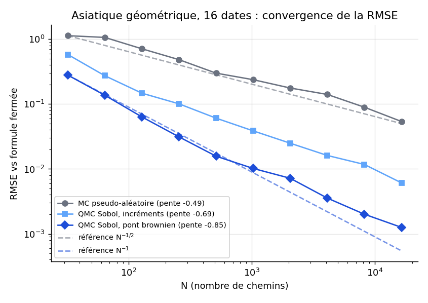

**Comment lire ce graphique.** Erreur RMSE sur le prix en fonction du nombre de chemins N, en échelle log-log : une droite de pente −1/2 est le Monte Carlo ordinaire, une droite plus raide est un gain réel. L'ordre « incréments » du QMC est moins bon que le pont brownien, qui concentre la variance dans les premières coordonnées (voir Q3).

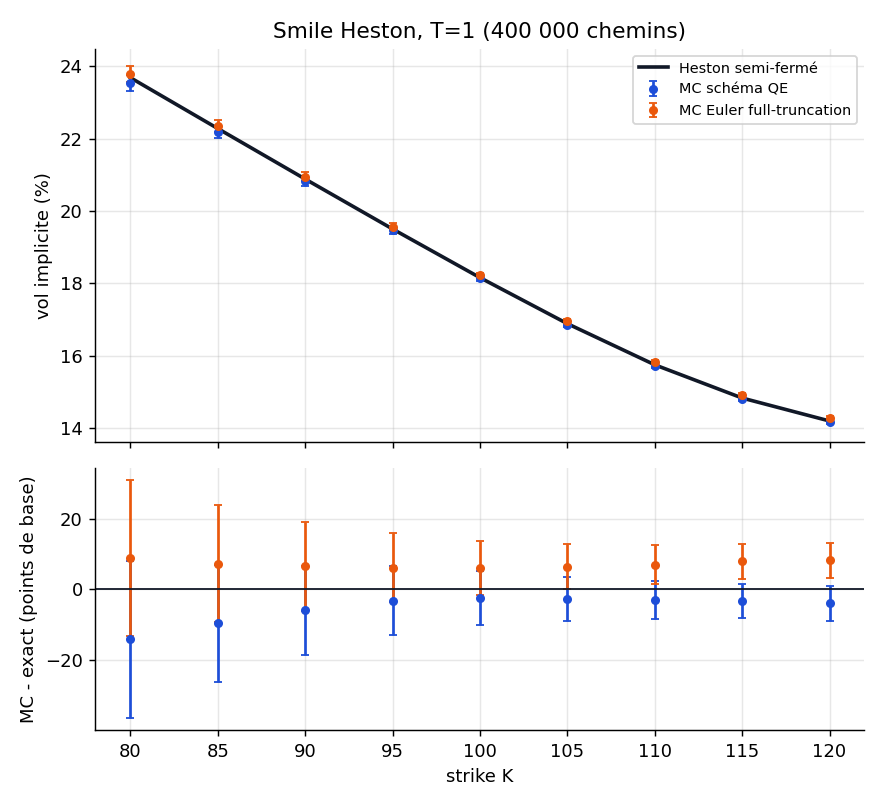

**Comment lire ce graphique.** Volatilité implicite en fonction du strike : la courbe noire est le prix semi-fermé de Heston (la vérité), les points avec barres sont les prix Monte Carlo de QE et d'Euler convertis en vol implicite. Plus les points collent à la courbe, meilleur est le schéma ; Euler à 50 pas reste décalé de quelques points de base.

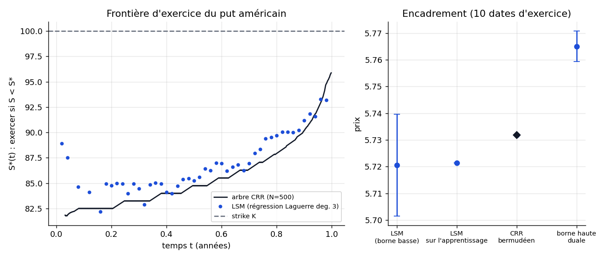

**Comment lire ce graphique.** Frontière d'exercice du put américain : en dessous de la courbe, il vaut mieux exercer. La frontière apprise par Longstaff-Schwartz doit épouser celle de l'arbre CRR ; l'encadrement borne basse / CRR / borne haute montre à quel point le prix est serré.

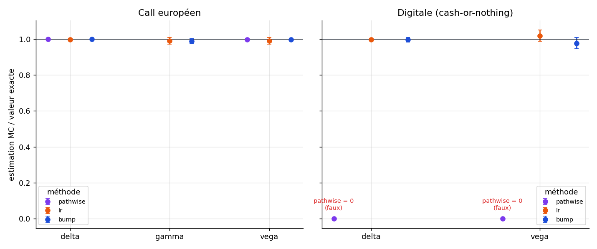

**Comment lire ce graphique.** Rapport estimation / valeur exacte pour trois méthodes de grecques (pathwise, rapport de vraisemblance, bump avec nombres aléatoires communs) : 1 est la bonne réponse. **Le pathwise tombe à 0 sur la digitale** (confiant et faux), le rapport de vraisemblance et le bump s'en sortent.

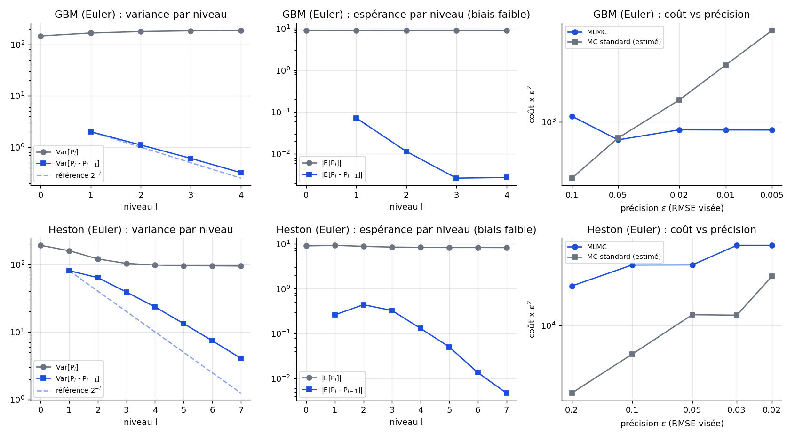

**Comment lire ce graphique.** À gauche, variance et espérance de la correction par niveau : leur décroissance en 2^(−β l) et 2^(−α l) fait le gain du MLMC. À droite, le coût multiplié par ε² en fonction de ε : une courbe qui descend sous celle du Monte Carlo standard est un gain réel (ici sur GBM, pas sur Heston dans la plage testée).

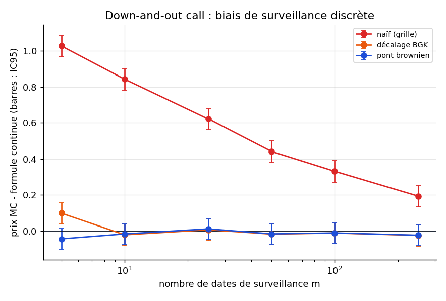

**Comment lire ce graphique.** Erreur du prix de la barrière discrète par rapport à la formule continue selon le nombre de dates de surveillance : le MC naïf reste biaisé de plusieurs dizaines d'erreurs-types, tandis que le décalage BGK et le pont brownien retombent sur la référence même avec peu de dates.

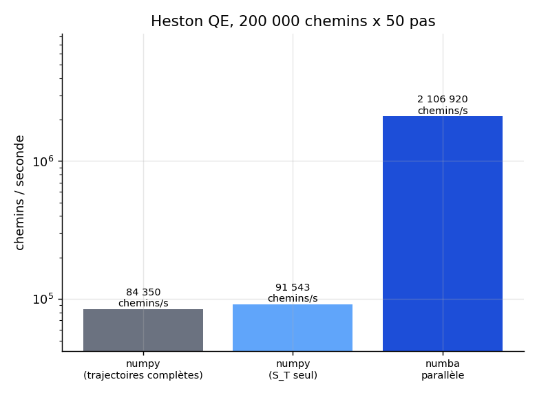

**Comment lire ce graphique.** Chemins simulés par seconde : numpy en trajectoires complètes, numpy pour S_T seul, numba parallèle. Les vitesses dépendent de la machine ; seul le rapport (environ ×23) est à retenir.

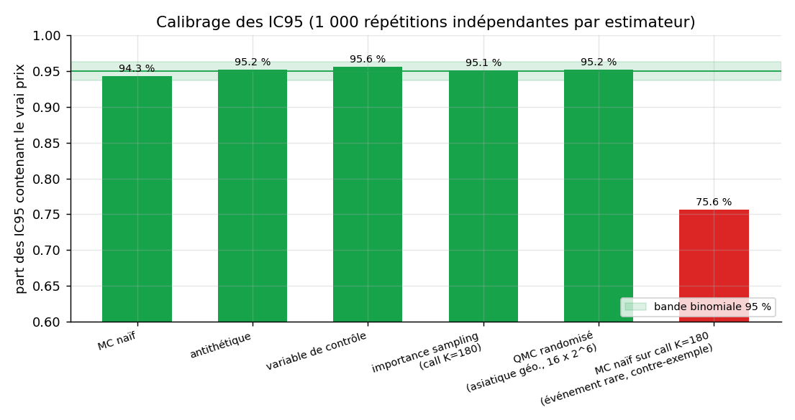

**Comment lire ce graphique.** Part des intervalles de confiance à 95 % qui contiennent la vraie valeur sur 1 000 répétitions ; la bande est la fluctuation binomiale attendue autour de 95 %. Les cinq estimateurs sont dans la bande ; le contre-exemple (MC naïf sur un événement rare) est très en dessous, preuve que l'IC normal peut mentir quand il y a trop peu de tirages utiles.

**Volet risque.**

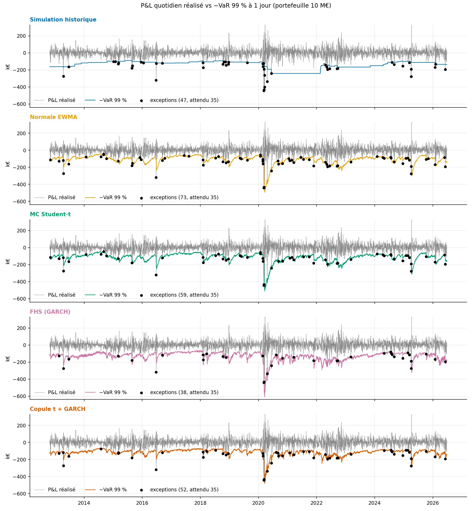

**Comment lire ce graphique.** Un panneau par méthode : P&L quotidien du portefeuille de 10 M€ (gris), −VaR 99 % (couleur) et exceptions (points noirs, là où la perte dépasse la VaR). La VaR doit remonter quand le marché s'agite (mars 2020) et redescendre ensuite ; un amas de points noirs sous la courbe est un modèle trop optimiste.

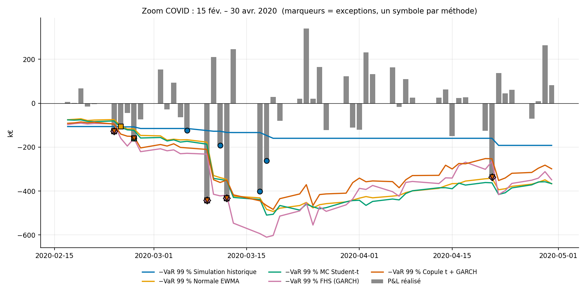

**Comment lire ce graphique.** Zoom sur mars 2020 : barres grises = P&L, courbes = −VaR 99 % des cinq méthodes, marqueurs = exceptions (un symbole par méthode). La VaR n'est utile que si elle s'ajuste *avant* la perte du 9 mars, pas après.

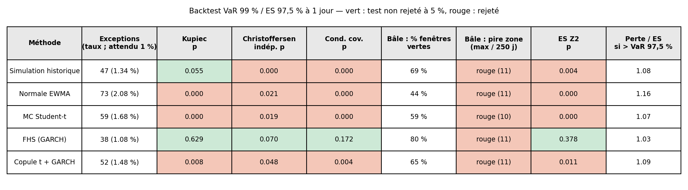

**Comment lire ce graphique.** Une ligne par méthode : exceptions observées (attendu 1 %), p-values de Kupiec, de Christoffersen, de l'ES, feux de Bâle. Case verte = test non rejeté à 5 %, rouge = rejeté. Les autres figures du volet risque (`risque_zoom_2022.png`) sont décrites dans [docs/risque.md](docs/risque.md).

## Ce qu'on retient (lectures)

- **Les erreurs-types sont calibrées** : 94 à 96 % de couverture pour le MC naïf, l'antithétique, la variable de contrôle
  (beta pilote), l'importance sampling et le QMC randomisé. **Contre-exemple instructif** : le MC naïf sur un call très
  hors de la monnaie (événement rare, 2 000 chemins) ne couvre que ~76 % des cas : l'IC normal est trop étroit ;
  l'importance sampling corrige à la fois la précision et la couverture.
- **Variable de contrôle sur l'asiatique arithmétique** : facteur de variance supérieur à 1 000 avec la géométrique
  (corrélation ~ 1), sans biais. L'antithétique ne gagne que ~1,7x sur un call : c'est le résultat théorique attendu.
- **QMC** : pente mesurée proche de -0,5 pour MC, -0,69 pour Sobol en ordre naïf, **-0,85** avec le pont brownien. On
  n'atteint pas -1 sur ce payoff (coude en max(., 0) et 16 dimensions) ; on rapporte la valeur mesurée, pas la valeur de manuel.
- **Heston** : les paramètres de référence **violent la condition de Feller** (2 kappa theta = 0,12 < xi^2 = 0,25). Euler
  full-truncation a un biais visible à 10 pas (plusieurs erreurs-types), qui se résorbe vers 100 pas ; le schéma QE est
  compatible avec le semi-fermé dès 10 à 20 pas.
- **Barrière** : le MC naïf est biaisé haut de plusieurs dizaines d'erreurs-types, biais qui décroît lentement avec le nombre
  de dates ; le pont brownien (et le décalage BGK) retombent sur la formule continue même à 10 dates. Ce biais est
  *invisible à l'erreur-type* : seule la comparaison à la référence l'expose.
- **LSM** : estimateur hors échantillon biaisé bas, encadré par une borne haute duale (écart de la borne haute au CRR
  bermudéen dans le tableau ci-dessus : faible à 10 dates, plus lâche à 50 dates).
- **Grecques** : le pathwise est le plus précis sur le call, mais **inapplicable à la digitale** (il renvoie 0 avec une
  erreur-type nulle : confiant et faux) ; LR et bump (nombres aléatoires communs) fonctionnent.
- **MLMC** : variance par niveau en ~2^(-0,9 l) sur GBM (2^(-0,7 l) sur Heston), exposant du coût en 1/eps de 1,96 (GBM) et
  2,31 (Heston) contre ~2,9 pour le MC standard. Sur GBM le MLMC devient moins cher que le MC standard vers eps = 0,05
  (rapport 0,96) et l'est 7 fois plus à eps = 0,005 ; sur Heston il reste plus cher dans la plage testée (voir la limite ci-dessous).

<!-- AUTO:approfondissement:DEBUT -->
## Approfondissement

Huit questions précises, chacune avec un théorème énoncé, une expérience qui le vérifie ou le met en défaut et une conclusion chiffrée. Tout est lu dans `results/approfondissement.json` (régénéré par `scripts/run_approfondissement.py`, graines fixées) ; le détail pas à pas est dans `notebooks/approfondissement.ipynb`. Les chronométrages de Q6 et les durées dépendent de la machine.

### Q1 À quelle vitesse l'erreur de discrétisation tend-elle vers 0 pour Euler et Milstein (forte et faible), et ces ordres survivent-ils à Heston ?

*Théorème* : Euler : ordre fort 1/2, faible 1. Milstein (terme b b' (dW^2 - dt)/2) : ordre fort 1, faible 1 (Kloeden-Platen), pour des coefficients réguliers.

- GBM, erreur forte (même brownien) : Euler en dt^0,49 [0,49 ; 0,49] (théorie 1/2) ; Milstein en dt^1,00 en L2 et dt^0,94 en L1 (théorie 1 ; la pente locale L1 vaut 0,99 aux pas les plus fins).
- GBM, erreur faible : Euler 0,72 ± 0,09 (call, bruité), Milstein 0,98 ; sans bruit (E[S^2] exact) 0,997 et 0,998 : ordre faible 1 pour les deux.
- CIR : les ordres du théorème exigent Feller. Feller respecté (F = 3,0) : Euler 0,65, Milstein 1,07 ; Feller violé (F = 0,48, paramètres du projet) : Euler 0,40, Milstein 0,68.
- Heston, biais faible du prix : Euler full-truncation 0,522 à 4 pas -> 0,028 à 32 pas -> 0,004 ± 0,002 à 128 pas ; QE : -0,004 à 4 pas, compatible avec 0 (chi2 p = 0,30), erreur-type 0,002.

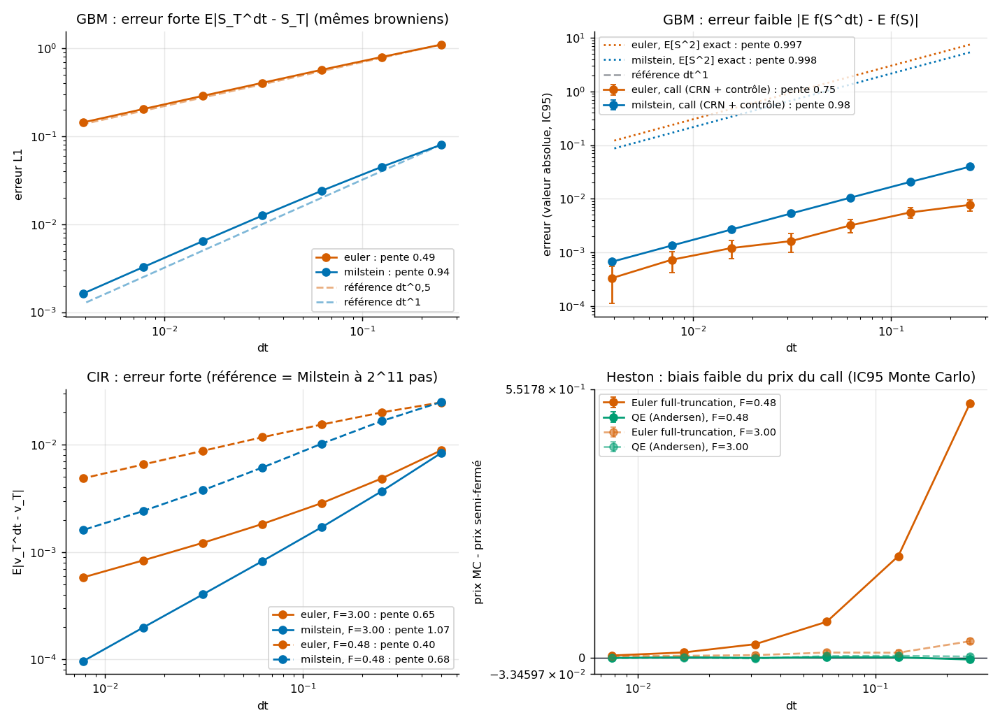

**Comment lire ce graphique.** Quatre panneaux en log-log où la pente est l'ordre de convergence : erreur forte du GBM, erreur faible du GBM (barres = IC95), erreur forte du CIR (traits pleins = Feller respecté, pointillés = violé) et biais du prix Heston (Euler full-truncation contre QE). Une courbe qui s'écarte de la droite de référence contredit le théorème ou sort de son domaine de validité.

### Q2 Milstein rend-il le MLMC en O(eps^-2) : que valent alpha, beta, gamma mesurés, et quel gain de coût ?

*Théorème* : Giles (2008) : si |E[P_l - P]| <= c 2^(-alpha l) avec alpha >= min(beta, gamma)/2, V_l <= c 2^(-beta l) et C_l <= c 2^(gamma l), le coût pour une RMSE eps est O(eps^-2) si beta > gamma, O(eps^-2 (log eps)^2) si beta = gamma, O(eps^-(2+(gamma-beta)/alpha)) si beta < gamma.

- beta (variance par niveau, V_l ~ 2^(-beta l)) : Euler 0,95 [0,93 ; 0,98], Milstein 1,95 [1,92 ; 1,98] (théorie 1 et 2) ; alpha (ordre faible) : Euler 0,62 [0,32 ; 0,93], Milstein 0,98 [0,98 ; 0,98] ; gamma = 1 (pas fins).
- Giles : Euler beta ~ gamma donne eps^-2 (log eps)^2 ; Milstein beta > gamma donne eps^-2. Coût mesuré en eps^-x : x = 2,20 [1,98 ; 2,43] (Euler), 1,94 [1,82 ; 2,06] (Milstein), 3,08 pour le MC standard.
- Gain de coût de Milstein sur Euler (pas fins) : x1,3 à eps = 0.05 -> x3,6 à eps = 0.002 (coût x eps^2 : Euler 1526, Milstein 429) ; la croissance en log^2 d'Euler est masquée par le niveau 0 sur cette plage.
- Heston : beta passe de 0,81 (Euler) à 0,96 (Milstein) sur le cas du projet, mais atteint 2,12 [1,99 ; 2,24] seulement si Feller est respecté ET si l'aire de Lévy est négligeable (rho -> -1).

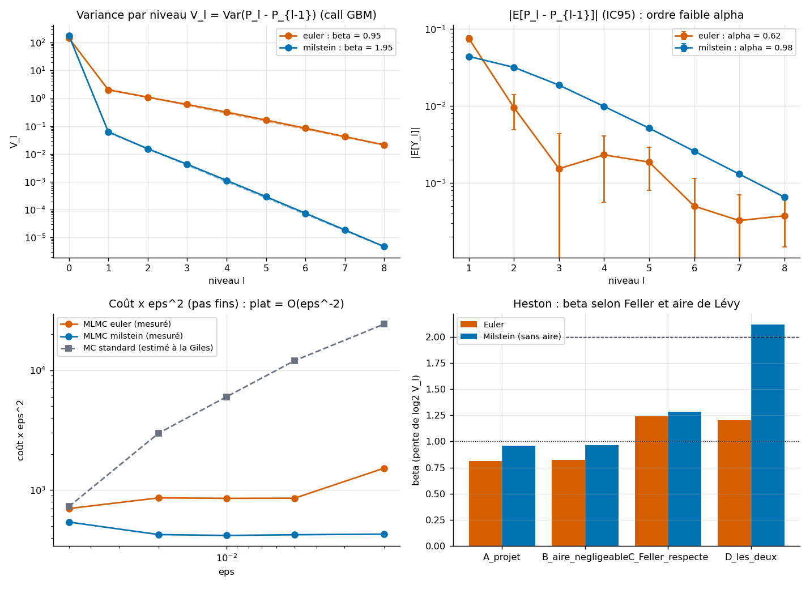

**Comment lire ce graphique.** Quatre panneaux : variance par niveau (pente = -beta), espérance par niveau (pente = -alpha), coût multiplié par eps^2 (une courbe plate est un coût en eps^-2 pur ; Milstein doit être plat et sous Euler) et beta de Heston selon Feller et l'aire de Lévy.

### Q3 Pourquoi le pont brownien (et l'ACP) rendent-ils le QMC plus précis sur l'asiatique : que mesure la dimension effective ?

*Théorème* : Décomposition ANOVA f = somme_u f_u ; variance expliquée par {1..k} = Var(E[f | Z_1..Z_k]) / Var f (Sobol fermé). Koksma-Hlawka : |I_N - I| <= V_HK(f) D*_N, avec D*_N ~ (log N)^s / N en dimension s : une fonction presque entièrement portée par ses s premières coordonnées (s petit) est intégrée à la vitesse de la projection de dimension s.

- Variance expliquée par la 1re coordonnée (d = 16) : 12,1 % (incrémentale), 72,6 % (pont), 98,4 % (ACP) ; par les 4 premières : 47,4 / 98,2 / 100,0 %.
- Dimension effective de troncature à 99 % : 14 / 7 / 2 à d = 16, 56 / 7 / 2 à d = 64 : seule la construction incrémentale en dépend (résolution 8 au-delà de k = 16).
- RMSE à N = 2^14 (d = 16) : MC 5.4e-02, incrémentale 6.2e-03, pont 1.2e-03, ACP 4.9e-04 (pentes -0,50 / -0,73 / -0,89 / -0,97).
- Koksma-Hlawka : l'erreur suit la discrépance de la projection qui porte la variance ; gain de l'ACP sur le pont : x2,5 à d = 16, x4,6 à d = 64.

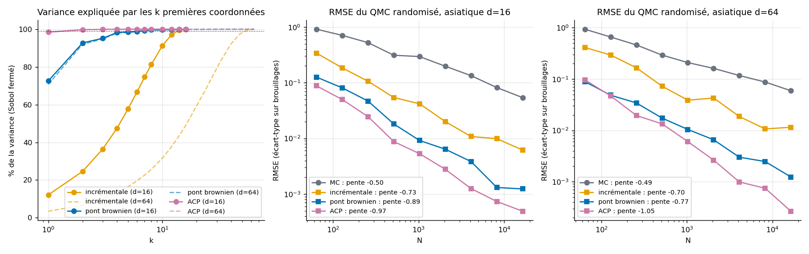

**Comment lire ce graphique.** À gauche, part de variance expliquée par les k premières coordonnées pour les trois constructions (plus la courbe monte vite, plus la dimension effective est petite) ; à droite, RMSE du QMC randomisé contre N pour d = 16, 32, 64 : ACP sous le pont, lui-même sous l'incrémental, MC en dernier.

### Q4 Stratifier le brownien terminal (proportionnel vs Neyman) ou utiliser un hypercube latin : combien de variance gagne-t-on, et la théorie le prédit-elle ?

*Théorème* : Stratification : Var = somme p_h^2 sigma_h^2 / n_h ; proportionnelle -> (1/n) somme p_h sigma_h^2 <= sigma^2/n (variance totale) ; Neyman n_h ~ p_h sigma_h -> (1/n) (somme p_h sigma_h)^2 <= proportionnelle (Cauchy-Schwarz). LHS (Stein 1987) : variance asymptotique (1/n)(sigma^2 - somme_j sigma_j^2), il ne retire que la partie additive.

- Stratification de la normale terminale, H = 64 (n = 4096), européen ATM : x92 mesuré (proportionnelle) contre x89 prédit par sigma^2 / somme(p_h sigma_h^2) ; Neyman avec sigma_h connus x1110 (théorie x1125). Précision de chaque facteur mesuré : ~4 %.
- Call OTM K = 140 (sigma_h très inégaux) : proportionnelle x6,7, Neyman x237 (oracle) et x180 (pilote n/8). Asiatique 16 dates (Z_1 du pont stratifiée) : x3,4 / x2,6 (pilote) / x5,7 (oracle), théorie 3,6 / 5,2 (proportionnelle / oracle).
- LHS (Stein) : somme des indices de Sobol d'ordre 1 = 0,749 (incrémentale), 0,896 (pont) -> gain asymptotique prédit x4,0 / x9,6 ; mesuré à n = 4096 : x3,8 / x9,7.
- Dimension 1 : le LHS est une stratification à n strates, variance en n^-2,02 contre n^-0,99 pour le MC.

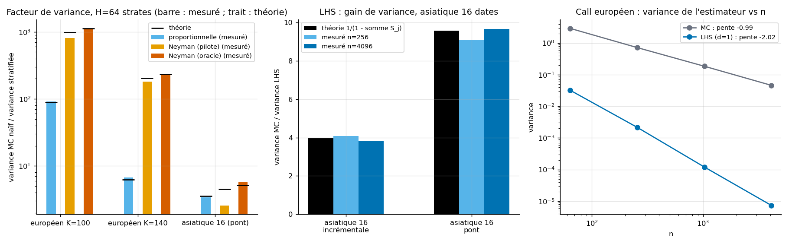

**Comment lire ce graphique.** Facteur de variance à H = 64 strates (barre = mesuré, trait = théorie : une barre sur son trait veut dire que la formule prévoit le gain), gain de variance du LHS sur l'asiatique, puis variance contre n en dimension 1 où le LHS suit n^-2.

### Q5 Quelle dérive de Girsanov minimise la variance d'un estimateur d'événement rare, et l'entropie croisée la retrouve-t-elle ?

*Théorème* : Pour Y ~ N(mu,1) et w = exp(-mu Y + mu^2/2), Var = M(mu) - I^2, M(mu) = E[f(Z)^2 exp(-mu Z + mu^2/2)] convexe : minimum unique mu*. Entropie croisée : mu_CE = E[f(Z) Z] / E[f(Z)]. Grandes déviations : pour {Z > a}, M(mu) = e^{mu^2} P(Z > a + mu), mu* ~ a, ln M(mu*) ~ 2 ln P (efficacité logarithmique).

- Call K = 180 : le second moment M(mu) est convexe ; mu* = 3,386 (variance divisée par 882), contre mu = z_K = 2,939 (x738, choix de v1) et mu_CE = 3,491 (x873). L'entropie croisée par 8 itérations de 20 000 tirages donne mu = 3,492 ± 0,003 (10 graines).
- Défaut rare (au moins 20 défauts sur 100, P = 4.04e-04) : mu* = -3,436, mu_CE = -3,465, variance divisée par 1098 (CE : 1097).
- La variance empirique (n = 400000) retrouve M(mu) - I^2 à 0,3 % près sur les dérives d'importance.
- Grandes déviations : ln M(mu*) / (2 ln P) = 0,844 (a = 2) -> 0,950 (a = 6) -> 0,992 (a = 20) ; l'erreur relative de l'IS ne vaut que 4,9 à a = 20 (MC naïf : 1.9e+44).

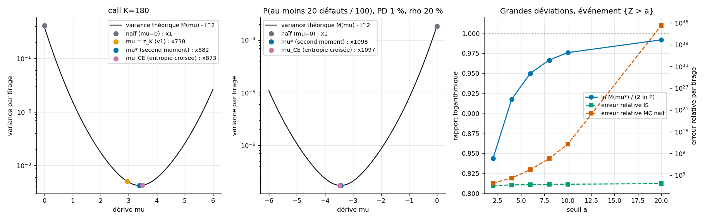

**Comment lire ce graphique.** Variance par tirage en fonction de la dérive mu pour chaque cas : une cuvette dont le fond est mu* (les repères montrent le choix naïf et l'entropie croisée) ; à droite, le rapport logarithmique qui tend vers 1 quand l'événement devient rare.

### Q6 Peut-on obtenir toutes les grecques d'un payoff pour ~3 à 4 fois le coût du prix, et sont-elles exactes ?

*Théorème* : Principe du gradient bon marché (Griewank) : TEMPS{F, grad F} <= omega TEMPS{F}, omega ~ 3-4, indépendant du nombre m de paramètres, par propagation d'adjoints bar x = dP/dx en sens inverse du graphe. Le bump-and-revalue coûte 2 m réévaluations.

- Exactitude : sur les mêmes chemins (n = 400000, 12 dates), l'AAD en mode inverse égale le pathwise écrit à la main à 6e-13 près en valeur absolue (grecques de l'ordre de 10 à 500) ; boucle et version vectorisée coïncident.
- Contre des références indépendantes : européen vs Black-Scholes z = 0,03 / 1,56 / -0,34 (delta / vega / rho) ; asiatique géométrique vs différences finies de la formule fermée z = 0,53 / 0,15 / 0,59.
- Coût relatif au prix (asiatique, 64 dates, 67 grecques dont 64 vegas par date) : AAD 3,3x (boucle) et 2,5x (vectorisé), contre 153x pour le seul bump-and-revalue des vegas (129 réévaluations).
- Le rapport AAD/prix reste dans 2,3-3,3x (boucle) quand m passe de 11 à 67 (Griewank : 3 à 4 en comptage d'opérations) ; accélération sur le bump : x46 (boucle) à x62 (vectorisé). Temps numpy : dépendent de la machine.

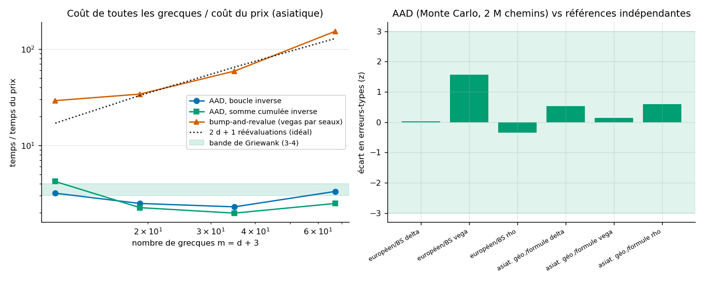

**Comment lire ce graphique.** À gauche, coût de toutes les grecques rapporté au coût du prix quand le nombre de grecques m augmente : l'AAD reste plat, le bump-and-revalue croît avec m (les temps dépendent de la machine) ; à droite, écart de l'AAD à des références indépendantes en erreurs-types (dans la bande verte +/-3 : compatible).

### Q7 Combien d'années de backtest faut-il pour détecter un modèle de VaR à 2 % d'exceptions au lieu de 1 %, et d'où vient l'ES du portefeuille ligne par ligne ?

*Théorème* : Puissance = P(LR > chi2_{1-a} | H1) ; sous H1 le nombre d'exceptions est Binomial(T, p1). Théorème d'Euler : F homogène de degré 1 => F(w) = somme_i w_i dF/dw_i ; pour l'ES, w_i dES/dw_i = E[perte de la ligne i | L >= VaR] et la somme des contributions vaut l'ES.

- Kupiec, modèle à 2 % au lieu de 1 % : puissance 24 % à 1 an, 54 % à 2 ans, 87 % à 5 ans, 98 % à 10 ans ; 80 % de puissance durable après 1130 jours (4,5 ans ; formule normale 3,9 ans). La taille réelle du test vaut 9,5 % à 1 an (pas 5 %).
- Bâle : un modèle à 2 % est en zone verte 44 % du temps sur 250 jours. Exceptions groupées de taux correct 1 % (pi11 = 0,20) : Christoffersen (indépendance) rejette 28 / 43 / 72 / 92 % à 1/2/5/10 ans, Kupiec seulement 9 % à 10 ans.
- ES FHS 97,5 % au 9 mars 2020 : 247 659 EUR ; somme des contributions d'Euler = ES à 2e-16 près ; dérivées numériques w_i dES/dw_i = contributions à 1e-10 ; ES(2w)/ES(w) = 2.000000.
- Parts de l'ES (poids du capital) : SPX 50 % (15 %), NSX 29 % (10 %), BCO 21 % (10 %), XAU -6 % (15 %) ; moyenne sur 59 dates : SPX 22 %, NSX 17 %, BCO 28 %, XAU 13 %.

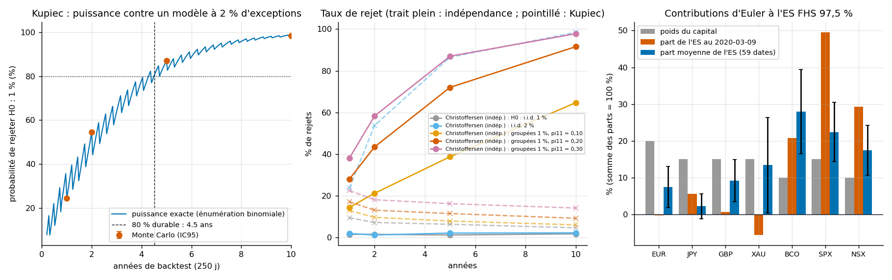

**Comment lire ce graphique.** Puissance du test de Kupiec contre l'horizon de backtest (courbe en dents de scie : loi discrète), taux de rejet de Christoffersen (trait plein) contre Kupiec (pointillé) sur des exceptions groupées, et contributions d'Euler de chaque ligne à l'ES (une barre négative est une ligne qui couvre).

### Q8 Que vaut la condition de Feller pour la discrétisation : quelle fraction de pas est tronquée selon 2 kappa theta / xi^2 ?

*Théorème* : CIR : le bord 0 est inatteignable ssi F = 2 kappa theta / xi^2 >= 1 (Feller 1951). La loi stationnaire est Gamma(F, xi^2/(2 kappa)) : P(v < eps) ~ eps^F. L'Euler full-truncation tronque quand v_n + xi sqrt(v_n dt) Z < 0, donc avec probabilité ~ dt^F.

- Pente log-log de la part des pas tronqués en dt : F = 0,25 -> 0,19 ; F = 0,50 -> 0,43 ; F = 1,00 -> 0,89 ; F = 2,00 -> 1,74 ; F = 4,00 -> 3,19 (la pente croît avec F = 2 kappa theta / xi^2 et reste sous F : régime non asymptotique).
- À 16 pas, la troncature touche 27 % des pas pour F = 0,25, 14 % pour F = 0,5 (cas du projet : 0,48), 4,2 % pour F = 1, 0,013 % pour F = 4.
- Biais relatif de E[v_T^+] à 16 pas : 1,3 % (F = 0,5) contre 0,23 % (F = 4).

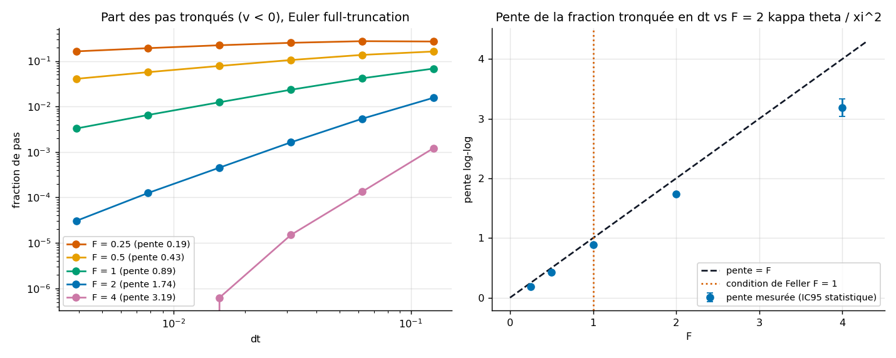

**Comment lire ce graphique.** À gauche, fraction de pas tronqués contre dt en log-log pour plusieurs F = 2 kappa theta / xi^2 ; à droite, la pente de ces droites contre F : elle croît avec F et reste sous la bissectrice tant que dt n'est pas assez petit.

<!-- AUTO:approfondissement:FIN -->

## Validation et tests

- **143 tests** (`python -m pytest -q`, environ 1 minute) : formules de référence comparées entre elles et à des méthodes indépendantes, chaque estimateur contre sa référence en erreurs-types, couverture des IC95, absence de fuite temporelle du volet risque, huit blocs de tests d'approfondissement (théorie contre mesure), cohérence README / JSON / figures, un README par dossier.
- **Sans données de marché** (dépôt public) : 142 tests passent et 1 est ignoré (`skipif` : contributions d'Euler à l'ES sur les vrais rendements, qui exige `UNIVERS_DIR`) ; les résultats chiffrés du volet risque restent lisibles dans `results/risque_backtest.json`.
- **Intégration continue** : `.github/workflows/tests.yml` (Ubuntu, Python 3.12, `pip install -r requirements.txt`, `pytest -q`).
- Les chiffres de ce README sont lus dans `results/*.json` ; `tests/test_readme_tete.py` vérifie que la tête du README égale ces fichiers.

## Limites honnêtes

- **MLMC sur Heston : aucun gain mesuré** dans la plage testée (rapport MLMC / standard de 6,8 à eps = 0,2 jusqu'à 1,7 à
  eps = 0,02). Les exposants (≈2,3 contre ≈2,8) montrent l'avantage asymptotique, mais la variance par niveau décroît
  lentement avec Euler full-truncation (~2^(-0,7 l)) ; le croisement, extrapolé vers eps ~ 7e-3, n'a pas été mesuré
  (trop coûteux). Sur GBM, croisement vers eps ~ 0,05. Le coût du MC standard est une **estimation à la Giles** (variance
  du niveau fin x nombre de pas imposé par le biais), pas une exécution.
- **Borne haute duale** : valide mais pas serrée à 50 dates. Une variante par **simulation emboîtée (Andersen-Broadie)** a été
  prototypée puis abandonnée : le bruit des sous-simulations donnait des bornes très lâches (de l'ordre de +8 % à 10 dates et
  +40 % à 50 dates, mesure de développement non rejouée par `run_all.py`). On utilise à la place une espérance conditionnelle
  par **quadrature** (le pas GBM est lognormal) avec une valeur approchée de degré 7 : sans bruit, mais dépendante de la
  qualité de cette approximation.
- **LSM** : estimateur biaisé bas par construction. Écart relatif au CRR **américain** (N=2000) dans `validation.json` :
  -0,49 % (put ATM, 50 dates), -0,35 % / -0,59 % / **-1,07 %** pour S0 = 36 / 40 / 44 (cas de Longstaff-Schwartz 2001,
  K=40) : le put le plus hors de la monnaie **dépasse 1 %** (dont ~0,3 % viennent de la seule discrétisation bermudéenne).
  Les estimations portent sur un put **bermudéen** à 10 ou 50 dates, comparé à un arbre bermudéen sur les mêmes dates ;
  le CRR américain N=2000 n'est pas exact non plus (erreur ~ 1e-3, oscillante en N).
- **Références non fermées** : l'asiatique arithmétique est comparée à un **MC haute précision** (8 x 250 000 chemins avec
  variable de contrôle), pas à une formule ; son z combine les deux erreurs-types.
- **Schéma QE** : version standard (K0 sans correction de martingale) ; le biais résiduel est invisible à nos erreurs-types
  (voir la parité call-put) mais existe en principe.
- **QMC randomisé** : la convergence est étudiée sur l'asiatique géométrique (référence exacte). Sur un payoff 1-D avec peu
  de brouillages (K=8) l'IC de Student sous-couvre (~92 % en développement) ; la couverture rapportée est celle de la
  configuration utilisée (K=16, 16 dimensions).
- **numba** : générateur SplitMix64 par chemin (pas PCG64) pour que le résultat ne dépende pas du nombre de threads ;
  l'équivalence avec la version numpy est **statistique** (même prix à l'erreur-type près), pas bit à bit. Le noyau ne
  renvoie que S_T. Les vitesses dépendent de la machine (nombre de coeurs logiques indiqué dans `validation.json`).
- **Verdicts à 3 sigma** : 45 comparaisons à graines fixées ; sous H0 une comparaison sur 370 dépasserait 3 sigma par
  hasard, donc un écart isolé de 2 à 2,5 sigma n'est pas un signal. Les résultats sont déterministes à graine donnée.
- **Approfondissement : limites propres.** (i) L'AAD est codée à la main pour un GBM discret à volatilité par date ; ce n'est pas un outil de différentiation automatique générique. (ii) Les chronométrages (Q6, `benchmark_numba`) dépendent de la machine et de sa charge : une première exécution sur machine saturée avait donné un coût AAD inférieur au prix, ce qui est impossible ; on mesure donc le minimum de plusieurs répétitions contre un prix de référence minimal, et on ne retient que les rapports. (iii) Q7 (contributions d'Euler à l'ES réel) exige les données de marché (`UNIVERS_DIR`) ; sans elles ce bloc est ignoré. (iv) Les asymptotiques de Q1, Q2, Q8 sont mesurées sur des pas finis : une pente sous la valeur théorique peut venir du régime non asymptotique (Q8) plutôt que d'un défaut du schéma.
- **Pas fait** : GPU, calibration au marché, vol locale ou rugueuse, mini-xVA, Milstein avec aire de Lévy (le Milstein de Q2 sur Heston omet ce terme, d'où β < 2 hors du cas favorable).

## Tout relancer

```bash
pip install -r requirements.txt
python -m pytest -q                              # tests (environ 1 min ; les tests du volet risque réel sont ignorés sans données)
python scripts/run_all.py                        # validation.json + figures + tableaux de ce README (~2,5 min)
python scripts/run_approfondissement.py          # approfondissement.json + figures appro_*.png + section du README (~7 min)
python scripts/build_readme_tete_01.py           # figure héro + tableaux de tête du README, lus dans results/*.json
python -m jupyter nbconvert --to notebook --execute --inplace notebooks/visite_guidee.ipynb          # notebook de visite (~1 min)
python -m jupyter nbconvert --to notebook --execute --inplace notebooks/approfondissement.ipynb      # notebook d'approfondissement (~10 min)
```

Volet risque (données de marché requises, non fournies) : `export UNIVERS_DIR=/chemin/vers/data/processed/univers` (dossier des
`<ACTIF>_1h.csv`, par exemple `EURUSD_1h.csv`), puis `python scripts/run_risque.py` (~2,5 min) qui écrit `results/risque_backtest.json`
et les figures `risque_*.png`. Sans cette variable, tout le reste fonctionne et les tests concernés sont ignorés.

## Arborescence

```
01_monte_carlo_lab/
  mclab/            20 modules : pricing (utils, analytique, modeles, reduction_variance, qmc, barriere, americaine, grecques,
                    mlmc, accel, validation), risque (risque), approfondissement (schemas, anova, stratification, importance,
                    aad, puissance, contributions_es, experiences) ; README.md : une ligne par module
  tests/            un fichier par module + tests d'approfondissement (pytest, graines fixées, tolérances en erreurs-types)
  scripts/          run_all.py, run_risque.py, run_approfondissement.py, figures*.py, build_*_01.py (notebook, tête du README)
  notebooks/        visite_guidee.ipynb, approfondissement.ipynb (intuition -> formule -> attente -> expérience -> lecture)
  results/          validation.json, risque_backtest.json, approfondissement.json, tableau_validation.md
  figures/          hero, 9 figures de pricing, 5 du risque, 8 de l'approfondissement ; README.md : une ligne par image
  docs/             risque.md (méthodologie et résultats du volet risque)
  .github/workflows/tests.yml   CI : pytest sur Python 3.12
```

## Positionnement face aux dépôts GitHub

À partir d'une recherche de ~70 dépôts publics sur le Monte Carlo en finance (`projets_cv/_recherche/github_montecarlo.md`,
README et racines balayés le 2026-10-13 ; un notebook peut contenir ce que le README ne cite pas, donc ordres de grandeur) :
**seulement 4 README sur 70** parlent d'intervalle de confiance ou d'erreur-type, **5 sur 70** de convergence,
**2 sur 70** d'antithétique, **2 sur 70** de variable de contrôle, **0 sur 70** de stratification (traitée ici : proportionnelle, Neyman, hypercube latin), **1 sur 70** de pont brownien.

| Dépôt (étoiles) | Ce qu'il fait bien | Ce que ce labo ajoute |
|---|---|---|
| [cantaro86/Financial-Models-Numerical-Methods](https://github.com/cantaro86/Financial-Models-Numerical-Methods) (7 492) | notebooks pédagogiques : Heston, Merton, Lévy, EDP, américain | Monte Carlo au centre : IC95 partout, tests pytest, antithétique / contrôle / Sobol + pont, étude de convergence |
| [ArturSepp/StochVolModels](https://github.com/ArturSepp/StochVolModels) (239) | bon réflexe « MC validé contre Fourier », noyaux numba | réduction de variance, QMC, courbes erreur-vs-N, tests de couverture ; ici aussi Heston QE vs semi-fermé, mais avec tolérance en erreurs-types |
| [QMCSoftware/qmcpy](https://github.com/QMCSoftware/qmcpy) (93) | référence QMC : Sobol, lattices, critères d'arrêt adaptatifs | **application de bout en bout** : asiatique avec Sobol brouillé + pont brownien, erreur-type par brouillages, pente mesurée vs MC (qmcpy reste plus complet comme bibliothèque, ici seulement ce qu'il faut au pricing) |
| [luphord/longstaff_schwartz](https://github.com/luphord/longstaff_schwartz) (52) | paquet LSM propre, CI, documentation | **borne haute duale**, évaluation hors échantillon explicite (biais bas vs biais de prévoyance), comparaison à un arbre bermudéen sur les mêmes dates |
| [Yunfan-Wang/CMU15418-High-performance-Longstaff-Schwartz-Solver](https://github.com/Yunfan-Wang/CMU15418-High-performance-Longstaff-Schwartz-Solver) (54) | LSM CPU + CUDA (13,9x), limites écrites honnêtement : « pas d'erreur contre un oracle exact » | l'oracle exact (arbre CRR 2 000 pas, bermudéen sur les mêmes dates), les IC et l'encadrement (pas de GPU ici) |
| [auto-differentiation/xad](https://github.com/auto-differentiation/xad) (432) | AAD adjointe pour le MC (C++) | comparaison **pathwise vs LR vs bump (CRN)** avec erreur-type, y compris sur un payoff discontinu où le pathwise échoue ; AAD en mode inverse **codée à la main** sur un GBM discret, exacte à 1e-12 près contre le pathwise (pas de bibliothèque d'AD générique) |
| [lballabio/QuantLib](https://github.com/lballabio/QuantLib) (7 666) | référence mondiale, moteurs MC et formules fermées | autre échelle : QuantLib est la vérité terrain ; ce labo est lisible de bout en bout et fournit les études (convergence, couverture) qu'il ne propose pas prêtes à l'emploi |
| [google/tf-quant-finance](https://github.com/google/tf-quant-finance) (5 523) | MC sur GPU/TPU, Sobol, Heston, SABR | archivé (non maintenu) ; ici le chemin est inverse : peu de vitesse brute, mais chaque prix est validé et chaque gain chiffré |

Ce qui est **en plus** dans ce labo : prix MC toujours livrés avec erreur-type ; tolérance exprimée en erreurs-types ;
**test de couverture** des IC95 (1 000 répétitions, avec le contre-exemple de l'événement rare) ; parité call-put sur les prix
MC ; tableau « facteur de variance et efficacité » par technique ; pente de convergence mesurée ; Greeks par trois méthodes
dont une qui échoue volontairement sur la digitale ; LSM encadré par le haut ; MLMC avec exposants de coût (Euler et Milstein) ; stratification, hypercube latin, importance sampling optimal et AAD avec la théorie énoncée puis confrontée à la mesure ; volet risque à cinq méthodes backtestées ; figures et JSON
régénérés par une seule commande. Ce qu'ils font **mieux ou que nous ne faisons pas** : couverture produit (QuantLib), AAD générique (xad),
GPU (tf-quant-finance, CMU15418), cadre QMC adaptatif (qmcpy), pédagogie sur EDP/Fourier (cantaro86).

## Summary (English)

A validated Monte Carlo pricing lab (Python, numpy, scipy, numba; no QuantLib): GBM, Heston (Euler full-truncation and
Andersen's QE) and Merton simulators, each estimator returning a price with standard error and 95% CI, checked against
closed/semi-closed formulas (Black-Scholes, Heston Fourier, Merton series, geometric Asian, continuous barrier, CRR tree).
It covers variance reduction with measured efficiency, randomized Sobol QMC with Brownian bridge, discrete-barrier
bias correction, Longstaff-Schwartz with an independent evaluation set and a dual upper bound, pathwise / likelihood-ratio /
bump Greeks (including the digital case where pathwise fails), MLMC, and a numba-parallel Heston QE kernel.
A 1,000-repetition coverage test checks that the 95% intervals are honest; limits (MLMC on Heston, loose dual bound at 50
dates) are documented. A market-risk module backtests five VaR/ES methods (historical, EWMA normal, Student-t Monte Carlo,
filtered historical simulation, t-copula) with Kupiec, Christoffersen and Acerbi-Szekely tests, and an in-depth section tests eight
theorems (Euler/Milstein orders, Giles' MLMC theorem, effective dimension for QMC, stratification, optimal importance sampling,
hand-coded adjoint Greeks, backtest power, Feller condition) against measurements, reporting where theory and data disagree. Everything regenerates with `python scripts/run_all.py`; tests with `python -m pytest -q`.
